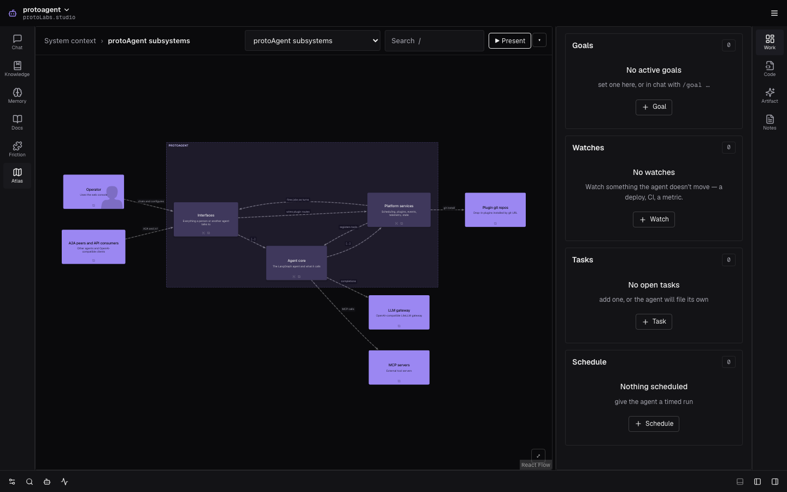
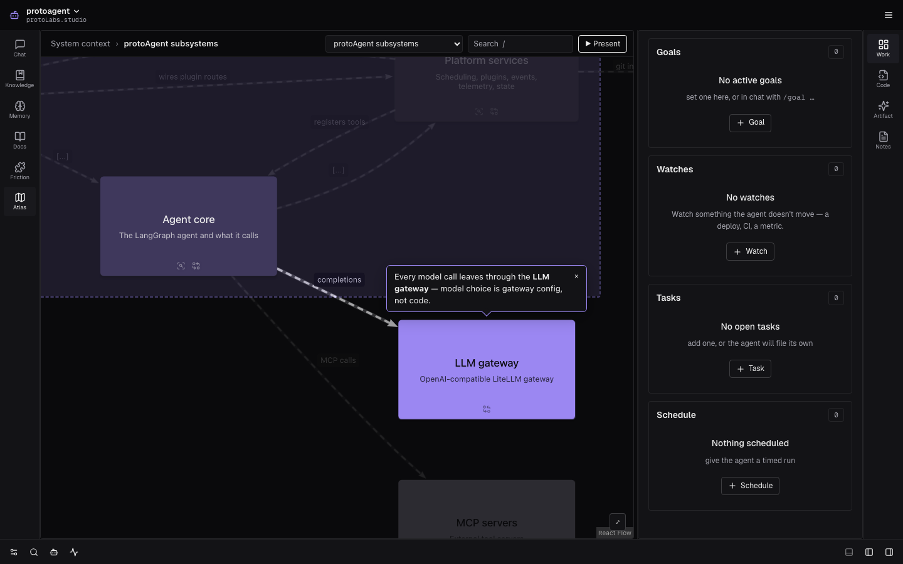
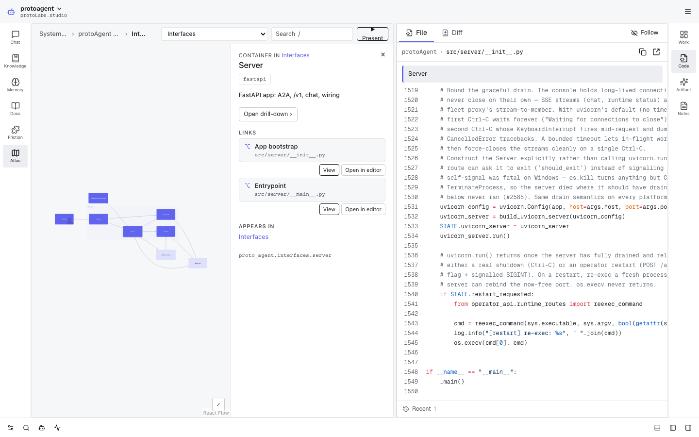

# Atlas

Drill-down architecture diagrams you can explore, present, and record — a
[protoAgent](https://github.com/protoLabsAI/protoAgent) plugin built on [LikeC4](https://likec4.dev).

Atlas renders a project's LikeC4 model as a console view: one model, many views. Click into an
element to see what's inside it, follow its code links into the console's code pane, and run
guided tours in presenter mode — or autoplay a tour as a captioned walkthrough you can record.
The agent writes the model with its normal file tools (guided by the bundled skill), then checks
it, describes it, and narrates it live: it moves the view, highlights elements and relationship
paths, pins callouts, and steps through flows while you watch.



| Live narration | Code links |
|---|---|
|  |  |

## Install

```bash
protoagent plugin install https://github.com/protoLabsAI/atlas-plugin
```

Atlas ships **disabled**. Enable it in **Settings ▸ Plugins ▸ Atlas**; an **Atlas** button then
appears in the console's **right sidebar**, so chat stays open on the left while the agent drives
the diagram. Drag the icon to the left rail if you prefer it there; the console remembers.

### Requirements

| Need | Why |
|---|---|
| protoAgent **0.182.0** or newer | The `protoagent:code:open` bridge message (code links → code pane). |
| **Node.js 20** or newer | The layout engine (`vendor/atlas-engine.mjs`) is a Node program. Atlas uses `node_path` if set, then `node` on PATH, then protoAgent's managed Node runtime. |

If no usable Node is found, Atlas raises a setup banner with an **Install Node runtime** button
(protoAgent's managed runtime, one click) and a **Set Node.js path** shortcut. The banner clears
itself once a Node is found. A macOS app launched from the Dock and the Docker image usually have
no `node` on PATH — the managed runtime covers both.

Two features need a newer host than the floor and stay hidden or degrade on older ones — see
[Host versions](docs/agent-tools.md#host-version-requirements).

## Quickstart

1. Enable Atlas and open it from the rail. With no model yet it says *No architecture map yet*.
2. In chat, ask: **"Map this project's architecture."** The agent writes LikeC4 files into
   `<project>/architecture/`, runs `atlas_validate` until the model is clean, and the view picks
   the model up within two seconds.
3. Click into the diagram. Press **P** to present the tour, or ask the agent to *walk me through
   how a request flows* and watch it drive the view.

Want to see it first? [`examples/protoagent/`](examples/protoagent) is a complete model of
protoAgent itself — 34 elements, 8 views, a 10-step flow, and an 85-second tour. Copy it into a
project's `architecture/` folder to try it.

## Controls at a glance

| Explore | |
|---|---|
| Click a node | Select it — the inspector shows its details, links, and where else it appears |
| A node's drill-down icon, **Open drill-down ›**, or *Drill in* (right-click) | Zoom into the element's own view |
| Breadcrumb / view picker | Jump to any level |
| **/** | Search elements and views |
| **P** or **▶ Present** | Present the first tour, starting at the current view |
| **▾** (*Tour options*) | Present, Autoplay, or Record any tour |

| Present | |
|---|---|
| **→** **Space** **PgDn** / **←** **PgUp** | Next / previous slide (and each step of a whole-flow slide) |
| **Home** / **End** · **1**–**9**, **0** | First / last slide · jump to slide 1–9, 10 |
| **Enter** | Drill into the focused node |
| **Esc** **Backspace** | Up a level; at the top, exit |
| **.** / **,** | Focus the next / previous node |
| **N** · **F** | Toggle notes · fullscreen |
| **[** / **]** | Slower / faster transitions for this session |

The full guide is [docs/user-guide.md](docs/user-guide.md).

## Settings

**Settings ▸ Plugins ▸ Atlas** (config section `atlas`). Read live — a change applies on the next
request; `transition_speed` on the next view load.

| Key | Label | Type | Default | Meaning |
|---|---|---|---|---|
| `model_dir` | Model directory | string | `architecture` | Where the LikeC4 model (`.c4` files + `likec4.config.json`) lives. Relative to the project root, or an absolute path. |
| `project` | Project | string | *(blank)* | The filesystem project the model describes (a name from **Settings ▸ Filesystem**). Code links open files in it. Blank picks the console's project, else the first one. |
| `node_path` | Node.js path | string | *(blank)* | A Node.js 20+ executable to run the layout engine with. Blank uses `node` on PATH, then protoAgent's managed Node runtime. |
| `transition_speed` | Transition speed | `slow` \| `normal` \| `fast` | `normal` | How fast the viewer zooms into a drill-down and crossfades between views (explore and presenter). Reduced motion still wins. In the presenter, **[** and **]** adjust it for the session. |

## Documentation

| Guide | For |
|---|---|
| [User guide](docs/user-guide.md) | Operators: exploring, presenting, recording, live narration, theming, troubleshooting |
| [Authoring](docs/authoring.md) | Writing the model and `atlas.tours.json`; every lint rule |
| [Agent tools & API](docs/agent-tools.md) | The five tools, bus topics, HTTP routes, bridge messages |
| [Architecture](docs/architecture.md) | How the engine, backend, and viewer work, and the security model |
| [Development](docs/development.md) | Building, testing, releasing, and extending Atlas |
| [LikeC4 skill](skills/atlas/SKILL.md) | The agent's authoring reference (LikeC4 syntax, verified errors) |
| [Changelog](CHANGELOG.md) | Release history |

## License

[MIT](LICENSE) © 2026 protoLabs.

The prebuilt engine (`vendor/`) and viewer (`static/`) bundles include third-party code under its
own licenses: MIT, Apache-2.0, BSD-3-Clause, 0BSD, ISC, BlueOak-1.0.0, and EPL-2.0 for the
Graphviz inside the layout engine. The full texts, and where to get Graphviz's exact source, are
in [THIRD_PARTY_NOTICES.md](THIRD_PARTY_NOTICES.md).
