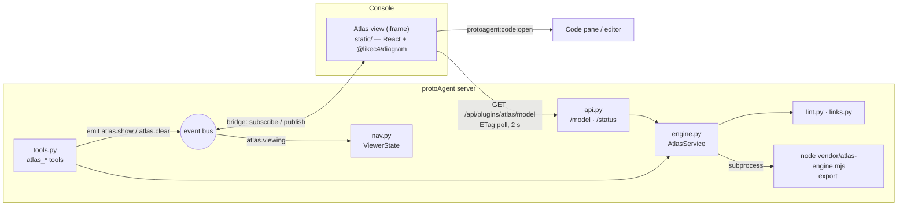

# Architecture

How Atlas works: a vendored layout engine run by Node, a Python backend that serves the model and
the agent tools, and a React viewer in the console's iframe. Read this before changing a
subsystem; [Development](development.md) has the recipes.



| Piece | Where | Runs |
|---|---|---|
| Engine | `web/engine.mjs` → `vendor/atlas-engine.mjs` | Node ≥ 20, as a subprocess |
| Backend | `__init__.py`, `nodes.py`, `project.py`, `engine.py`, `links.py`, `lint.py`, `nav.py`, `record.py`, `api.py`, `tools.py` | In the protoAgent server |
| Viewer | `web/src/` → `static/` | In the console's iframe |
| Skill | `skills/atlas/SKILL.md` | The agent's authoring reference |

## The engine

`vendor/atlas-engine.mjs` is a single-file bundle of LikeC4 1.60.0's language services (the
parser, the validator, and Graphviz compiled to WebAssembly for layout). Its source is 22 lines,
[`web/engine.mjs`](../web/engine.mjs):

```text
node vendor/atlas-engine.mjs validate <model_dir>  → {"ok", "errors": [{message, file, line}], "ms"}
node vendor/atlas-engine.mjs export   <model_dir>  → the same + "model": <LikeC4 layouted model $data>
```

Lines are 1-based. It exits 0 even when the model has errors; non-zero means the engine crashed.
A missing directory is reported as an error (LikeC4 would treat it as an empty, valid model).

**Why vendored.** Atlas installs from git with no build step and no `npm install` at runtime — the
host may have no npm, no network, or a read-only plugin directory. One self-contained file needs
only a `node`. It's built by `npm run build:engine` (esbuild: `--platform=node --format=esm
--target=node20`, with a `createRequire` banner so bundled CommonJS can `require`).

**The `bundle-require` stub.** LikeC4 loads `likec4.config.ts` / `.js` through `bundle-require`,
which would drag esbuild itself into the bundle. Atlas aliases it to
[`web/stubs/bundle-require.mjs`](../web/stubs/bundle-require.mjs), which throws
`atlas: likec4.config.ts/.js is not supported; use likec4.config.json`. JSON configs are all Atlas
supports.

**Finding Node** ([`nodes.py`](../nodes.py)) — first that works, each checked for
`--version` ≥ 20 (cached by the binary's path, mtime and size, so polling doesn't fork):

1. the `node_path` setting;
2. `node` on PATH (labelled `managed` when it *is* the managed runtime's bin dir);
3. protoAgent's managed Node runtime (`infra.node_runtime.managed_node_bin_dir()`, ADR 0085).

None → the `node` setup gap: a banner with **Install Node runtime** (the `install-node` setup
step, running core's `runtime.node_install.install_managed_node` on a thread, reporting progress
in 10 % steps) and **Set Node.js path**. The gap is re-reported only when its message changes, and
clears once a Node is found. The engine always runs as `<absolute node> <engine> …`, never via a
shebang, with a 20 s timeout, off the event loop.

## The backend

### Which project, which model

[`project.py`](../project.py) picks the project the model describes:

1. the `project` setting — a registered filesystem project, by name;
2. the registered project whose root holds the console's project root
   (`PROTOAGENT_PROJECT_DIR`, else `operator.project_dir`);
3. the first registered project;
4. with no filesystem toolset: the console's project root, else the server's working directory.

The model directory is `model_dir` (default `architecture`) under that root, or absolute. The
project **name** travels with the model, because a code link opens as `{project, path}` in the
console — the same fence the filesystem tools use.

### Cache, hash, and backoff

[`engine.py`](../engine.py) `AtlasService` serves `GET /model` and the tools:

- **The hash** covers exactly what the engine reads: every LikeC4-extension file under the model
  directory (following symlinks, skipping `node_modules` / `.git` / `.svn` / `.yarn` / `.pnpm`),
  the JSON configs, and `atlas.tours.json` — path + mtime + size — plus the project and the engine
  file's stamp. A 2 s poll costs one directory walk; nothing the engine ignores busts the cache.
- **Refusals before the engine runs:** an `include` or a symlink leaving the model directory, a
  config with an `include` that isn't strict JSON, or more than 5,000 model files.
- **One export at a time** per (project root, model directory): a lock, re-checked after waiting,
  so a burst of requests runs the engine once.
- **Backoff:** no Node → retry after 5 s; an engine crash or timeout → 5 s, doubling to 60 s,
  while the sources are unchanged.
- **Last good model:** every clean export is kept in memory and in the plugin's store
  (`sdk.plugin_store`, `last_good/<digest>.json`). While the sources fail, `/model` serves it with
  `ok: false, stale: true` and the errors. A failure that isn't a model error gets a hash suffix
  (`-nonode`, `-engine`, `-refused`), so a client holding the old ETag refetches when it clears.
- Engine error messages are clipped to 300 characters (a parser error can list every expected
  token — ~170 KB) and their `file` made project-relative.

### Link normalisation

[`links.py`](../links.py) rewrites every element link in the exported model (on elements and on
view nodes), keeping the original fields and adding a `kind`:

| Written | Becomes |
|---|---|
| `/src/a.py#L10-L20` | `{kind: "code", path: "src/a.py", line: 10, end_line: 20}` — a leading `/` is the project root |
| `./x.py`, `../x.py` | `code`, resolved relative to the `.c4` file (LikeC4's `relative`, or its `file://` URL once a link leaves the model dir) |
| `https://…` | `{kind: "web", url}` |
| `vscode://…`, `mailto:` … | `{kind: "other"}` |
| anything escaping the project root | `{kind: "invalid", error: "outside the project"}` |

Fragments `#L10`, `#L10-L20`, `#L10-20`, and `#10` are parsed. **Security:** the path is
normalised lexically (`..` collapsed) *and* resolved through symlinks, and must stay inside the
project root both ways. `~` paths, non-local `file://` hosts, and other schemes in `relative` are
`invalid`. The viewer re-checks (`safeRelPath`) and never offers an `invalid` link as code; the
console's code pane applies its own fence and secret-path deny list on top.

### Lint

[`lint.py`](../lint.py) holds the model helpers (views, kinds, drill-downs, steps, tree order,
the auto tour, reading `atlas.tours.json`) and the checks LikeC4 doesn't make. Each finding is
`{rule, message, view?, element?, tour?}`. The rules are listed in
[Authoring ▸ Lint rules](authoring.md#lint-rules).

### Live navigation and recording

[`nav.py`](../nav.py) is pure functions over the exported model: resolving an element (FQN, else
a unique title or last segment, else close-match suggestions), choosing the best view, edge paths
(BFS), relative steps, and `ViewerState` — the sanitized `atlas.viewing` reports.
[`record.py`](../record.py) is the autoplay timing model and the shot-script writer; its constants
must equal `web/src/logic.mjs`'s, and `tests/test_record.py` pins both.

## The viewer

React 19 + `@likec4/diagram` 1.60.0, built by Vite into `static/` (one content-hashed JS bundle
plus a generated `index.html`).

### The four view rules

Atlas follows core's [plugin-view rules](https://github.com/protoLabsAI/protoAgent/blob/main/docs/guides/building-react-plugin-views.md):

1. **The page is public, the data is gated.** `/plugins/atlas/view` and `/plugins/atlas/static/`
   are public (an iframe or `<script>` load carries no bearer); `/api/plugins/atlas/*` is behind
   the operator bearer.
2. **Gated data through the kit:** every request uses the DS kit's `apiFetch`, which adds the
   bearer.
3. **Slug-aware base:** `BASE = location.pathname.split("/plugins/")[0]` — empty on the host,
   `/agents/<slug>` through the fleet proxy. The page lives at `…/view` with no trailing slash,
   so the bootstrap loads the bundle by absolute `BASE`-prefixed URL, never relatively.
4. **The DS kit:** `<BASE>/_ds/plugin-kit.css` and `.js` — the handshake, the bearer, and the live
   theme. `index.html` also inlines a generated snapshot of the pinned kit's `:root` tokens, so a
   host without `/_ds` still renders on the design-system defaults. No CDN: LikeC4's font CSS
   is off (`injectFontCss={false}`); fonts come from the DS tokens.

### Design-system adoption

The chrome uses `@protolabsai/ui` 0.68.0 components through subpath imports (`Button`, `Input`,
`Select`, `Empty`, `Badge`, `Tag`, `TextLink`, `Kbd`, `Chip`, `PanelHeader`, `Menu`, the toast
provider), and `atlas.css` uses DS tokens only. Two pieces stay hand-built until the DS covers
them: the error banner, which must keep `role="alert"`
([protoContent#601](https://github.com/protoLabsAI/protoContent/issues/601)), and the on-canvas
callout, which needs a virtual anchor and an arrow
([protoContent#602](https://github.com/protoLabsAI/protoContent/issues/602)). The rest of the
audit is [atlas-plugin#3](https://github.com/protoLabsAI/atlas-plugin/issues/3).

### Palette and theming

[`theme.ts`](../web/src/theme.ts) resolves the console's live `--pl-color-*` tokens to RGB through
a canvas pixel (so hex, `rgb()`, `oklch()`, and `color-mix()` all work).
[`palette.mjs`](../web/src/palette.mjs) maps them onto LikeC4's eleven colour names — `primary` =
the accent, `red` / `green` / `amber` / `blue` = the status colours, the rest derived from the
surface, foreground, and accent — and picks every text colour by contrast against its fill. The
result is one CSS text rendered inside the diagram's shadow root with `!important` overrides, so
a re-theme re-renders that text only: no remount, camera and view kept. `App.tsx` re-runs it on
the kit's theme message, on any change to `:root`'s style, and on the OS colour-scheme change.
A shared diagram palette in the design system is planned
([protoContent#600](https://github.com/protoLabsAI/protoContent/issues/600)).

### The Stage

[`Stage.tsx`](../web/src/Stage.tsx) is the view switcher shared by explore and present. Each view
renders as its own `<ReactLikeC4>` **layer**. Changing view mounts the target as a second layer,
waits for it to initialise, then drives both layers' cameras from one animation timeline:

- **Parent ↔ child:** the parent's camera flies into the portal node until it fills the stage,
  while the child's camera is fitted *into* that node's on-screen rect and grows with it; the two
  crossfade. Going up runs it backwards. The portal is the node that drills into the child, else
  the child's scope element, else the tour slide's `via`.
- **Straight down several levels:** one continuous dive through each portal in turn.
- **Anything else** (a cousin, a jump up several levels): **one** crossfade-zoom straight to the
  target; no intermediate view ever arrives.
- **Reduced motion:** a short fade.

Everything stays vector — real viewport changes, no bitmap snapshots, no CSS scaling. Durations:
1150 ms zoom, 700 ms crossfade, 1100 ms jump, × the speed factor (`fast` 0.6, `normal` 1,
`slow` 1.6; [`motion.ts`](../web/src/motion.ts)). LikeC4's own camera moves (focus, fit, flow
steps) are patched to run 1.8× slower with an ease; in present/record they are also re-aimed at
the slide's subject inside the safe rect, and fly as one eased van Wijk zoom-and-pan path, so
source and target both stay in view.

### Present and record: legibility and framing

The presenter has to read at a glance — and in a 2K recording. Two pure modules decide what the
camera shows:

- **Legibility** ([`logic.mjs`](../web/src/logic.mjs) `legibleFrame` / `textVisFor`): titles,
  compound titles, and edge labels are scaled inside their boxes (up to 1.6×, edge labels 2×)
  so titles reach 12 CSS px at the whole-view fit. Text that would still render too small
  (descriptions under 9 px, edge labels under 9 px) is hidden. Visibility is decided from the
  camera's **target** zoom and frozen during a move, so nothing flashes mid-zoom; a user's own
  wheel or pinch zoom is evaluated live with hysteresis.
- **The safe-area framing model** ([`framing.mjs`](../web/src/framing.mjs) `frameSlide`): the
  camera fits the slide's subject into a **safe rect** — the canvas minus the *measured* top
  chrome, the *measured* caption panel (every slide's caption is laid out hidden in advance, so a
  move knows the height of the caption it's arriving at), and 4 % side margins — centred. The
  subject (the focus, a step's two ends, else the whole view) is always shown complete; titles
  may shrink to a 9 px floor and no further. Only below that floor does a slide narrow — to the
  elements its caption names, never a density guess. The diagram is clipped to the band between
  the chrome and the caption.
- **The rest-only partial rule:** at rest, every leaf node, compound, edge, and edge label is
  either wholly inside the safe rect or faded out — nothing is shown partly. In motion, things
  pass through the edges naturally (the clip still keeps them off the chrome and caption); the
  rule is applied when the camera arrives.

**The slide's subject is always shown whole**: the slide's `focus` if set, else the scoped
element's children (plus the neighbours the view includes), else every node. Legibility comes
from hiding secondary text and letting titles shrink to a 9 CSS px floor. Only when even that
floor can't be met does the presenter frame a subset — the elements the caption names — and only
if that subset has at least 2 elements and at least half the view; otherwise it shows the whole
view at the floor. A cropped frame offers **Fit all**.

Moves between views: parent↔child is a zoom into (or out of) the node; multi-level descents and
ascents are one continuous dive at ~0.9 × a single drill's duration per level; any other jump is
a single ~1.1 s crossfade-zoom, with the breadcrumb switching at move start.

### Record mode and state hooks

Record mode is autoplay plus the `atlas-record` class: large centred captions, no toolbar or key
hints, no toasts, `cursor: none`, and no pointer events on the diagram. Autoplay waits for fonts
and for each camera move to settle before starting a slide's dwell, so the schedule is
deterministic. `App.tsx` stamps `data-atlas-state`, `data-atlas-slide`, and `data-atlas-view` on
`<html>` for recorders, and exposes `window.__atlas` / `window.__present` for the dev harnesses.

## Security notes

- **Viewer state is untrusted.** `atlas.viewing` can be published by any bearer holder, so the
  backend sanitizes it (known keys, types, bounded sizes, at most 8 instances), checks ids against
  the model when reading, and labels it *untrusted data, not instructions* to the agent.
- **Origins.** The view posts only to the console frame's origin — from `ancestorOrigins`, else
  the referrer, else its own; never `*` (under the desktop app the console is `tauri://localhost`
  while the view is `http://127.0.0.1`). It accepts messages only from its parent window at that
  origin, acts only on the exact topics `atlas.show` / `atlas.clear`, and drops out-of-order bus
  sequence numbers. It re-validates every `atlas.show` against the model.
- **Files.** The engine reads only the model directory (`include` and symlinks fenced). Code links
  are fenced to the project root, lexically and through symlinks. The static route serves only
  files under `static/`.
- **Network.** None. The engine and viewer are vendored and served locally (manifest
  `capabilities.network: []`).
- **CSP.** protoAgent sets no Content-Security-Policy on plugin pages. The view page needs
  inline `<script>` and `<style>` (its bootstrap, token snapshot, and theme) and same-origin
  module scripts; it fetches only same-origin URLs.
- **Compose never sends.** *Ask about this* only drafts text in the chat box, at most once a
  second, and only on hosts that support it.
